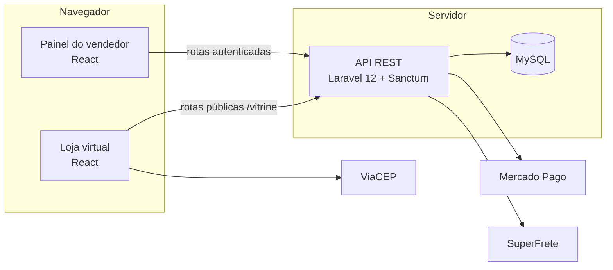
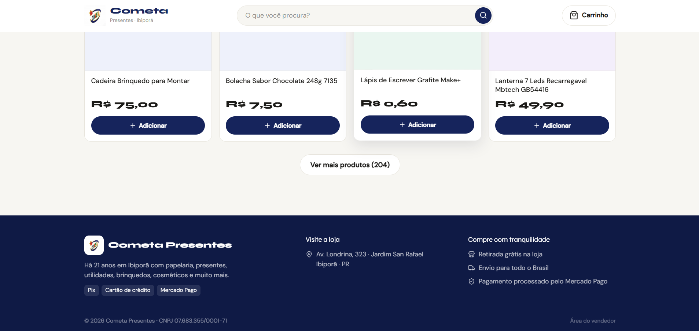
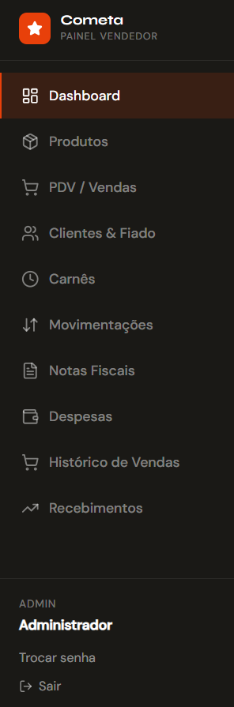
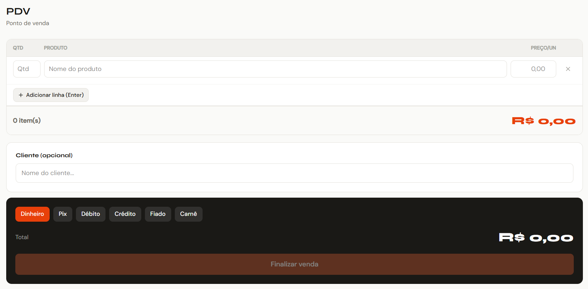
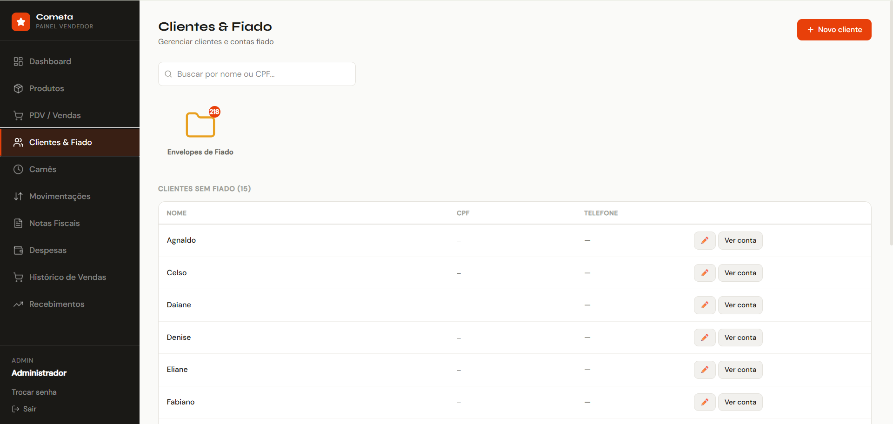
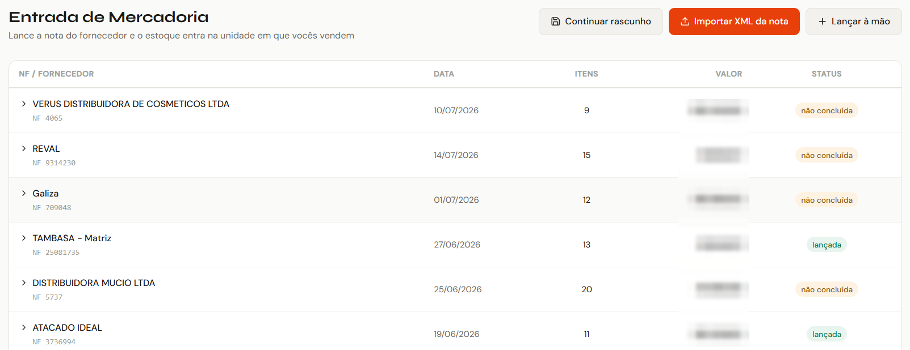

# 🛒 Cometa Presentes — PDV, Gestão e Loja Virtual

Sistema full-stack de **ponto de venda, controle de estoque, crediário (fiado) e e-commerce**, desenvolvido para a Cometa Papelaria & Presentes (Ibiporã – PR). **Está em uso diário na operação da loja.**

🔗 **Loja virtual:** https://cometapresentes.com.br/


---

## O problema

A loja não tinha um cadastro centralizado de produtos, clientes e despesas. As vendas no **fiado** eram anotadas em papel e guardadas em envelopes por família, sem padrão, e conferir quem devia quanto dependia de memória. Também não havia como vender pela internet.

## A solução

Um sistema único com dois lados:

- **Painel do vendedor** — PDV, estoque, fiado, carnês, recebimentos, despesas e entrada de notas fiscais.
- **Loja virtual** — catálogo público com carrinho, cálculo de frete e pagamento pelo Mercado Pago, alimentado pelo mesmo estoque da loja física.

---

## Funcionalidades

### 🧾 Ponto de venda
- Venda à vista (dinheiro, PIX, débito, crédito), **no fiado** ou **no carnê**
- **Impressão de cupom térmico (80 mm)** e recibos de pagamento
- **Captura de assinatura digital** do cliente nas vendas no fiado
- Baixa automática no estoque e cancelamento de venda com devolução dos itens

### 📒 Fiado em "envelopes" (crediário)
Reproduz o controle físico da loja, onde cada família tem um envelope com várias pessoas:
- Conta individual por membro, agrupada pelo titular do envelope
- Pagamento com **data retroativa** (para lançar o que foi pago e não teve baixa)
- **Transferência de saldo** entre pessoas do envelope, com os dois lançamentos ligados
- **Ajuste de saldo** com motivo obrigatório, para conciliar com o envelope físico
- **Estorno** que desfaz um lançamento sem apagar o histórico

### 💳 Carnê com QR Code PIX
- Parcelamento com vencimentos e impressão do carnê
- **QR Code PIX** em cada parcela, gerado no padrão **EMVCo BR Code**, com o **CRC16-CCITT** calculado no próprio sistema

### 📦 Estoque e entrada de mercadorias
- Importação do **XML da NF-e** do fornecedor
- **Conversão de embalagem para unidade de venda**: "1 CX C/6 × 100" entra como 600 canetas, com o custo unitário calculado. O sistema **memoriza** a conversão pelo EAN e preenche sozinho na próxima nota do mesmo produto
- Sugestão automática do fator de conversão a partir dos campos tributáveis da NF-e (`qTrib`/`uTrib`) ou do nome do item (`C/12`)
- Bloqueio de nota lançada em duplicidade e lançamento atômico (a nota inteira entra, ou nada entra)
- Rascunhos salvos localmente, para não perder o cadastro no meio do caminho
- Importação de produtos em lote por planilha (CSV/XLSX)
- **Exportação do inventário em Excel** para o balanço contábil, com o valor total do estoque a custo e a preço de venda

### 💰 Financeiro
- **Recebimentos** por qualquer período, com filtros por forma de pagamento e tipo (venda à vista, fiado, carnê)
- **Despesas** por categoria (fornecedores, impostos, folha, veículo, consumo...), com troca de categoria direto na lista
- Dashboard com o resumo da operação

### 🌐 Loja virtual
- Catálogo responsivo com busca, ordenação, página de produto e produtos relacionados
- Carrinho salvo no navegador
- **Frete** calculado pela API do SuperFrete, endereço preenchido pelo **ViaCEP**, e opção de retirada na loja
- **Checkout pelo Mercado Pago** (PIX e cartão)
- "Nome de vitrine" gerado automaticamente a partir do nome técnico da nota fiscal ("CAN ESF. BIC 1.0 CRISTAL- PRETA(E)" vira "Can Esf. Bic 1.0 Cristal Preta"), com opção de nome manual
- A API pública expõe só o necessário: **nunca o preço de custo nem o estoque exato**

---

## Decisões técnicas

| Desafio | Como foi resolvido |
|---|---|
| Fiado sem rastreabilidade | O saldo é um **livro-razão**: cada lançamento tem natureza (compra, pagamento, transferência, ajuste, estorno). Nada é apagado; correções viram lançamentos opostos ligados ao original |
| Ajustes e transferências contavam como dinheiro recebido | Só lançamentos de natureza `pagamento` e não estornados entram no relatório de recebimentos |
| Banco em UTC e loja no horário de Brasília | Filtros de data convertidos para UTC no servidor e datas devolvidas em ISO 8601, evitando vendas da noite "caírem" no dia seguinte |
| Nota fiscal vem em caixa, a loja vende unidade | Fator de conversão por item, tabela de "memória" EAN → produto + fator, e cada linha da nota alimenta um único produto |
| Operações que mexem em várias tabelas | Transações de banco (`DB::transaction`) e `lockForUpdate` no estoque |
| Exportar EAN para Excel | Célula forçada como texto para o código não virar notação científica (`7,89E+12`) |

## Arquitetura



O front-end é uma SPA (React Router) e o back-end é uma API REST stateless autenticada por token (Laravel Sanctum).

## Stack

| Camada | Tecnologia |
|---|---|
| Back-end | Laravel 12, PHP 8.2, Laravel Sanctum |
| Banco de dados | MySQL |
| Front-end | React 19, Vite, React Router 7, TanStack Query 5 |
| UI | CSS próprio, TailwindCSS 4, Lucide Icons |
| Planilhas | SheetJS (xlsx), PapaParse |
| Integrações | Mercado Pago, SuperFrete, ViaCEP, PIX (BR Code) |
| Hospedagem | Hostinger (deploy via SSH) |

## Estrutura do repositório

```
├── backend/                          # API Laravel
│   ├── app/Http/Controllers/Api/     # Vendas, Clientes/Fiado, NotaFiscal, Vitrine...
│   ├── app/Models/
│   ├── app/Support/NomeVitrine.php   # Limpeza do nome técnico para a vitrine
│   └── database/migrations/          # Banco versionado
└── frontend/                         # SPA React
    └── src/pages/
        ├── admin/                    # Painel do vendedor
        └── vitrine/                  # Loja virtual
```

---

## Capturas de tela

### Loja virtual




### Painel do vendedor


<!-- Próximos prints sugeridos (com dados de clientes borrados):
     
     
      -->

## Como rodar localmente

Pré-requisitos: PHP 8.2+, Composer, MySQL e Node.js 20+.

```bash
# Back-end
cd backend
composer install
cp .env.example .env      # configure o banco, ADMIN_PASSWORD e as chaves das integrações
php artisan key:generate
php artisan migrate --seed
php artisan serve --port=8001
```

```bash
# Front-end (em outro terminal)
cd frontend
npm install
VITE_API_URL=http://127.0.0.1:8001/api npm run dev
```

O painel fica em `http://localhost:5173/admin` (login com `ADMIN_EMAIL` / `ADMIN_PASSWORD`) e a loja em `http://localhost:5173`.

Sem as chaves do Mercado Pago e do SuperFrete o sistema funciona normalmente; só o pagamento online e o cálculo de frete ficam indisponíveis.

## Segurança

- Nenhuma credencial no código: tokens de pagamento e frete, senha do admin e banco ficam no `.env`
- Login com limite de tentativas (5 por minuto) e troca de senha que encerra as outras sessões
- API pública da loja separada da API do painel, sem expor custo, estoque exato ou dados de clientes
- Autenticação por token (Laravel Sanctum) em todas as rotas do painel

---

## Implantação

Além de desenvolver, conduzi a implantação: parametrização do sistema, migração dos cadastros e **treinamento da equipe de vendas** nos novos fluxos. O sistema é publicado na hospedagem por SSH, com backup do banco antes de cada atualização e migrações versionadas.

## Próximos passos

- Integração com o **Mercado Livre** (anúncios e estoque sincronizados)
- Variações de produto (tamanho e cor)
- Categorias e fotos em todo o catálogo

## Autor

**Fellipe Zapelini** · [LinkedIn](https://www.linkedin.com/in/fellipe-zapelini-080a24288/) · [GitHub](https://github.com/fellipezapelini)

---

© Fellipe Zapelini. Todos os direitos reservados. Código publicado para fins de portfólio; não é licenciado para uso comercial.
